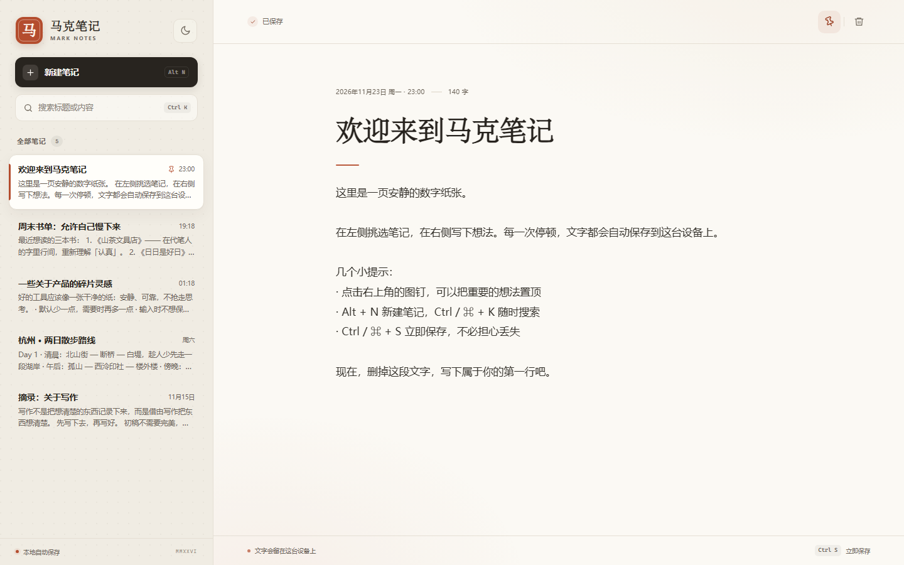

# 马克笔记 · MARK NOTES

一个用原生 HTML、CSS 和 JavaScript 编写的双栏笔记应用。左侧浏览与搜索笔记，右侧专注书写，内容自动保存在当前浏览器中。



## 功能

- **左侧笔记列表、右侧笔记内容**：桌面端固定双栏，边界清晰。
- **完整笔记管理**：新建、切换、编辑、置顶、删除，删除前有确认提示。
- **自动保存**：停止输入约 0.4 秒后保存，按 `Ctrl / ⌘ + S` 可立即保存；刷新或重新打开后恢复上次编辑的笔记。
- **搜索**：同时搜索标题和正文，无结果时有独立空状态，可用 `Esc` 快捷清除。
- **本地优先**：数据存储在浏览器 `localStorage`，不依赖后端，不上传任何内容。
- **明暗双主题**：跟随首次打开时的系统偏好，也可手动切换；偏好会保留。
- **移动端适配**：窄屏下先显示列表，点开笔记后进入专注编辑视图，可返回列表。
- **细节与可访问性**：字数和最后编辑时间、置顶状态、自定义删除确认框、键盘焦点样式、语义化区域、`aria-live` 保存状态提示。
- 没有任何第三方运行时依赖，也不加载外部字体或 CDN 资源。

## 运行

最简单的方式是直接双击 `index.html`。

为了让本地存储行为最稳定，推荐通过项目自带的静态服务器打开：

```bash
npm start
```

然后访问 <http://127.0.0.1:4173>。需要 Node.js 20 或更高版本；启动服务器不需要安装任何依赖。

## 快捷键

| 操作 | 快捷键 |
| --- | --- |
| 新建笔记 | `Alt + N` |
| 聚焦搜索 | `Ctrl + K` / `⌘ + K` |
| 立即保存 | `Ctrl + S` / `⌘ + S` |
| 清除搜索 | 搜索框内按 `Esc` |

> 不使用 `Ctrl + N` 作为新建快捷键，是因为多数浏览器会把它保留为“新建窗口”，网页无法可靠拦截。`Alt + N` 可以被页面稳定接收。

## 测试

```bash
npm test
```

测试分为两层：

1. **数据层单元测试**（16 项）：首屏示例数据、持久化与重载、空数组不被示例覆盖、置顶排序、搜索、内容截断、损坏数据恢复、存储配额异常、无效输入、防御性副本等。
2. **真实浏览器端到端测试**（12 组）：自动启动本机自带的 Microsoft Edge 或 Google Chrome，通过 DevTools Protocol 实际输入文字并操作界面。覆盖：
   - 双栏布局和首屏内容
   - 新建、真实输入、自动保存、刷新恢复
   - 标题与正文搜索、无结果状态、`Esc` 清除
   - 置顶排序及刷新后保留
   - 删除取消/确认及自动选择下一篇
   - 连续删除所有笔记、空状态、刷新后不重新填充
   - 键盘快捷键和手动保存
   - 明暗主题持久化
   - 390px 移动端列表/编辑切换与返回
   - 基础可访问性结构
   - 控制台无脚本异常

测试结束后会在 `tests/screenshots/` 生成桌面端明暗两套截图和移动端截图。浏览器自动化需要安装 Edge 或 Chrome；如浏览器不在常见路径，可通过 `EDGE_PATH` 或 `CHROME_PATH` 环境变量指定可执行文件。

```
tests/
├── store.test.cjs        # 数据层单元测试
├── e2e.test.cjs          # 真实浏览器端到端测试
├── browser.cjs           # 轻量 CDP 浏览器测试工具
└── screenshots/          # 验收截图
```

## 项目结构

```
index.html      # 应用结构、SVG 图标与无障碍标记
styles.css      # 主题变量、双栏/移动端布局和动效
store.js        # 无依赖的数据层，可独立在 Node.js 中测试
app.js          # 界面渲染、搜索、自动保存与交互
server.cjs      # 可选的本地静态服务器
tests/          # 单元测试、端到端测试和验收截图
```

## 数据说明

笔记保存在浏览器 `localStorage`：

- `marknotes.notes.v1`：笔记内容
- `marknotes.active.v1`：上次选中的笔记
- `marknotes.theme`：外观偏好

清除这些键即可恢复初始的示例笔记。当前浏览器禁用存储时，应用会自动退回临时内存模式，并在侧边栏底部给出提示，避免无提示的数据丢失。
